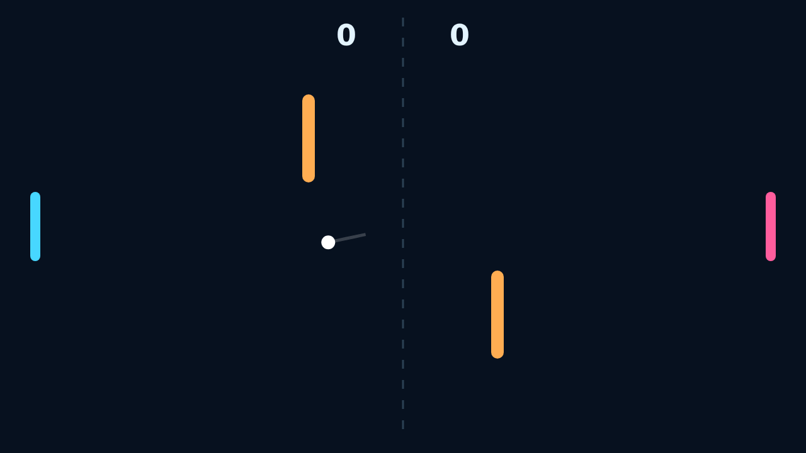

# Carom

Carom opens with a clean serve and a field built for bank shots. Keep the rally alive by reading the angles, moving your paddle into the ball, and sending it back before it slips past the far edge.

Every moving strike leaves a signature: paddle motion adds spin, spin bends the flight, and the orange obstacles turn a safe return into a choice. A wall bounce preserves speed; a paddle hit makes the next exchange faster.

Solo gives the right side to an alert AI, while Versus puts both paddles in human hands. The first player to reach eleven with a two-point lead takes the match, so close games stay tense through match point.

